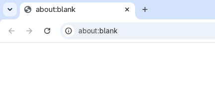
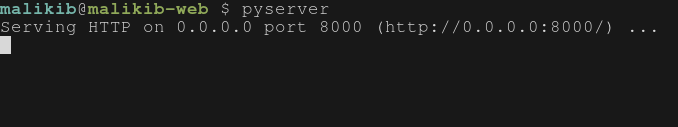
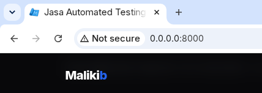
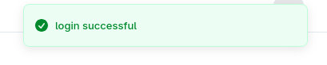

[kembali ke daftar isi](Daftar-isi.md)

# Page Syntax

catatan berisi syntax syntax playwright funtion Page

jikalau ingin menggunakan syntax page, jangan lupa untuk menulis page di sini

```typescript
test('skenario', async({ page }) => {})
                         ^^^
```

## Navigasi



saat awal Playwright di buka, dia berada di about:blank(seperti gambar di atas), kita harus mengarahkan nya ke link website yang ingin kita test, sesimple 

```typescript
page.goto('https://link-website.com')`
```

sesuaikan link nya masing-masing.

 jika website nya masih berada di local atau jalan di komputer sendiri seperti ini:



maka tinggal masukan saja link local nya`page.goto('http://0.0.0.0:8000/')`

maka jadi nya akan seperti ini:



simple kan? masih ada lagi syntax navigasi lainnya yang bisa di pakai:

```typescript
await page.reload() // untuk reload/refresh halaman
```

```typescript
await page.goBack() // untuk kembali ke halaman sebelumnya
```

```typescript
await page.goForward() // untuk maju ke halaman berikutnya
```

```typescript
await page.close() // untuk menutup tab/halaman tersebut
```

```typescript
await page.stop() // seperti menekan tombol silang saat refresh
```

```typescript
await page.url() // untuk mengambil url aktif halaman saat ini
```

```typescript
await page.content() // untuk mengambil seluruh html halaman
```

```typescript
await page.waitForUrl() // untuk menunggu url sesuai yang di inginkan
```

dan seterusnya... (masih banyak lagi, sesuaikan dengan kondisi ya...)

## Locator

sebelum lanjut, ada hal yang perlu kita pahami, yaitu HTML dan CSS, tenang.. gak perlu bisa bikin website statis dari nol, melainkan kita hanya perlu pahami fundamental nya seperti ini:

```html
<button class="inline-flex items-center 
justify-center gap-2 whitespace-nowrap 
rounded-md text-sm font-medium transition-colors 
text-primary-foreground shadow type="submit">Masuk</button>
```

#### 1. sesuaikan Role

ini adalah locator paling simple dan paling mudah di baca, juga kita di sarankan utamakan ini, kita hanya perlu mencocokan tag `html` dengan role nya masing masing, ada standar yang di namakan **WAI-ARIA Roles**, simple nya ini bisa bikin Playwright tahu element tiruan seperti `div` asal element tersebut di kasih sebuah role.

jika kita melihat html di awal penjelasan, kita hanya perlu menulis seperti ini:

```typescript
await this.page.getByRole('button', { name: 'Masuk' })
```

html tiruan yang di maksud akan terlihat seperti ini:

```html
<div role="button" class="submit">Masuk</div>
```

untuk syntax Playwright nya sama aja seperti di atas. kita hanya perlu mencocokan role nya.

**Ini adalah table role yang di dapat dari doc [developer.mozilla.org](https://developer.mozilla.org/en-US/docs/Web/Accessibility/ARIA/Reference/Roles/textbox_role)**

| Nama Role (Sintaks Playwright) | Tag HTML Asli (Implicit)            |
|:------------------------------ |:----------------------------------- |
| `'button'`                     | `<button>`, `<input type="submit">` |
| `'link'`                       | `<a href="...">`                    |
| `'textbox'`                    | `<input type="text">`, `<textarea>` |
| `'checkbox'`                   | `<input type="checkbox">`           |
| `'radio'`                      | `<input type="radio">`              |
| `'combobox'`                   | `<select>`                          |
| `'banner'`                     | `<header>`                          |
| `'navigation'`                 | `<nav>`                             |
| `'main'`                       | `<main>`                            |
| `'contentinfo'`                | `<footer>`                          |
| `'form'`                       | `<form>`                            |
| `'heading'`                    | `<h1>`, `<h2>`, `<h3>` ...          |
| `'img'`                        | ``                             |
| `'list'`                       | `<ul>`, `<ol>`                      |
| `'listitem'`                   | `<li>`                              |
| `'table'`                      | `<table>`                           |
| `'row'`                        | `<tr>`                              |
| `'alert'`                      | Elemen dengan `role="alert"`        |

sesuaikan masing masing, contoh penggunaan nya sama aja, seperti ini:

```typescript
await page.getByRole('textbox', { name: 'Email' })
```

#### 2. sesuaikan Label

ini opsi kedua jika kita tidak menemukan ada nya `type` atau `role` yang sesuai, kita bisa pakai Label untuk mencocokan nya. contoh html nya seperti ini:

```html
<label>Password <input /></label>
```

kita bisa pakai syntax ini:

```typescript
await page.getByLabel('Password')
```

#### 3.sesuaikan Placeholder

jika html seperti ini:

```html
<input type="email" placeholder="name@example.com" />
```

kita bisa pakai:

```typescript
await page.getByPlaceholder('name@example.com')
```

#### 4.sesuaikan Text

ini sering di pakai untuk assertion atau validasi, ini yang paling simple untuk di pakai karna mencocokan apa yang di lihat seperti pengguna melihat halaman tersebut.
contoh html seperti ini:

```html
<span>login successful</span>
```

walau tanpa html pun, kita bisa ambil text langsung dari yang kita lihat



kita bisa pakai:

```typescript
await page.getByText('login successful', { exact: false });
```

kalau untuk expect, akan seperti ini:

```typescript
await expect(page.getByText('login successful', { exact: false })).toBeVisible();
```

#### 5.sesuaikan data test id

ini adalah locator yang paling stabil, ini sangat di rekomendasikan untuk di pakai, tapi developer harus tambahin ini secara manual, harus ada kordinasi dengan developer nya

contoh html nya seperti ini :

```html
<button data-testid="tombol-masuk">Masuk</button>
```

kita bisa pakai:

```typescript
await page.getByDataTestId('tombol-masuk')
```

#### dan masih banyak lagi

untuk yang lain adalah locator yang jarang di gunakan oleh ku, tapi bisa baca di link bawah ini kalau mau 

[https://playwright.dev/docs/locators](https://playwright.dev/docs/locators)

## Basic Action

setelah dapat locator nya, untuk menyuruh Playwright melakukan aksi, kita perlu tambahkan syntax action nya seperti di table bawah ini:

| locator.check()         | ceklis input checkbox                        |
| ----------------------- | -------------------------------------------- |
| locator.uncheck()       | unceklis input checkbox                      |
| locator.click()         | klik sebuah element (seperti tombol)         |
| locator.hover()         | menaruh cursor pada sebuah element           |
| locator.fill()          | mengisi form dengan tulisan                  |
| locator.focus()         | mirip dengan hover, tapi ini untuk form      |
| locator.press()         | menekan sebuah element                       |
| locator.setInputFiles() | menaruh sebuah file( bisa gambar, video dll) |
| locator.selectOption()  | memilih pilihan dari dropdown                |

bisa di sesuaikan masing masing, misal kalau tombol bisa pakai `locator.click()`

untuk selengkapnya ada di sini [https://playwright.dev/docs/input](https://playwright.dev/docs/input)

contoh cara pemakaian nya seperti ini:

```typescript
await this.page.getByRole('button', { name: 'Masuk' }).click();
```

## Selanjutnya

kita berhasil menyuruh PLaywright melakukan aksi yang kita inginkan, misal seperti isi kolom, klik tombol dan sebagai nya.

selanjutnya kita akan belajar assertion atau validasi agar test tersebut bisa di katakan gagal atau berhasil. 

- [Assertion](./syntax-expect.md)

- [Daftar isi](Daftar-isi.md)
